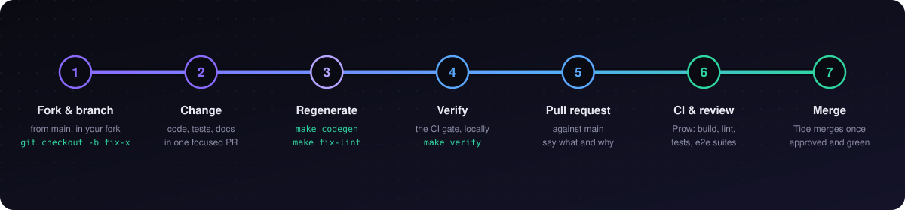

<p align="center">
  
</p>

# Contributing to railgrid

Thanks for your interest in contributing. This document covers building from
source, running a hub locally, the tests, and how a pull request gets merged.

| If you want to | Read |
|---|---|
| Build, run and test your change | this file |
| Understand the internals: the workspace tree, how an edge joins, how a call reaches it | [DEVELOPERS.md](DEVELOPERS.md) |
| Find your way around the code, the provider contract and the codegen pipeline | [AGENTS.md](AGENTS.md) |
| Change the portal or a provider's UI | [docs/design/README.md](docs/design/README.md) |

**Contents**

- [Prerequisites](#prerequisites)
- [Build](#build)
- [Run it locally](#run-it-locally)
- [Tests](#tests)
- [Before you push](#before-you-push)
- [Pull requests](#pull-requests)

---

## Prerequisites

| Tool | Version | Notes |
|------|---------|-------|
| Go | 1.26.10 or later | `go.mod` pins the exact version |
| Docker | any recent | must be running |
| kind | latest | local clusters, e2e suites |
| kubectl | 1.28+ | |
| Helm | 3.x | chart testing, `railgrid dev init` |
| Tilt | v0.35.0+ | only for `make tilt` |
| Node.js | 22 | only for the portal; the version CI builds with |

Everything else (controller-gen, kcp and its apigen, golangci-lint, dex) is
version-pinned and installed into `hack/tools/` by the Makefile the first time
a target needs it. Do not `go install` those globally.

## Build

```bash
git clone https://github.com/railgrid/railgrid.git
cd railgrid

make build            # everything, into bin/
make build-railgrid   # the CLI only
make build-hub        # the hub only
```

| Binary | What it is |
|--------|------------|
| `bin/railgrid` | The CLI. It is also the edge agent: `railgrid agent run` |
| `bin/railgrid-hub` | The hub server |

Providers are separate Go modules under `providers/`, each with its own
`go.mod`. The root `make build`, `make test` and `make lint` do not cover them;
build and test one from its own directory (`cd providers/kuery && go build
./... && go test ./...`) or with its `make build-<name>-provider` target.

## Run it locally

There are three ways to get a hub on your machine. Pick by what you are
changing.

| Loop | Command | What you get | Use it when |
|---|---|---|---|
| **Tilt** | `make tilt` | Hub with embedded kcp and static auth, the portal on a Vite dev server, providers, all rebuilt on change | Day-to-day work on the hub, the portal or a provider. See [DEVELOPERS.md](DEVELOPERS.md#local-development-with-tilt) |
| **`railgrid dev`** | `railgrid dev init` | Hub deployed from the Helm chart into a kind cluster, the way a user installs it | Checking the charts, or working on the agent against real clusters |
| **Bare hub** | `make run-hub-embedded-static` | The hub binary alone, no UI, one terminal per component | Debugging the hub or one provider in isolation |

All three use the static token `dev-token`. `railgrid dev` and the bare hub
serve at `https://console.127.0.0.1.sslip.io:9443`; `make tilt` allocates
ports per checkout, and `make tilt-status` prints them.

### `railgrid dev`

`railgrid dev init` creates a kind cluster for the hub, deploys the hub with
Helm, and wires everything together. The default is hub-only; pass
`--worker-count 1` (or more) to also get clusters to run agents on.

```bash
make build

# Hub + 1 worker kind cluster, hub deployed from the local chart
./bin/railgrid dev init --worker-count 1 --chart-path deploy/charts/railgrid-hub

# Log in with the static dev token
./bin/railgrid login --hub-url https://console.127.0.0.1.sslip.io:9443 \
  --insecure-skip-tls-verify --token dev-token

# Register an edge and print the agent command for it
./bin/railgrid edge create dev-edge-1
./bin/railgrid edge join-command dev-edge-1

# Run the agent against a kind cluster (writes .kubeconfig-railgrid-agent)
hack/scripts/ensure-kind-cluster.sh railgrid-agent
./bin/railgrid agent run \
  --hub-url https://console.127.0.0.1.sslip.io:9443 \
  --hub-insecure-skip-tls-verify \
  --token <join-token> \
  --edge-name dev-edge-1 \
  --type kubernetes \
  --kubeconfig .kubeconfig-railgrid-agent

# Tear down
./bin/railgrid dev delete
```

### Bare hub and Make shortcuts

```bash
make run-hub-embedded-static   # hub with embedded kcp and a static token; no Helm, no UI
make dev-portal                # a local portal pointed at the dev hub
make dev-login-static          # log in with the static token
make dev-edge-create           # create dev-edge-kube-1 (kubernetes type)
make dev-run-edge              # run the kubernetes agent (reads .env.edge.kubernetes)
make dev-edge-create TYPE=server                          # create dev-edge-server-1
make dev-run-edge    TYPE=server                          # run the server agent (reads .env.edge.server)
make dev-edge-create TYPE=server DEV_EDGE_NAME=my-server  # a custom name
```

### Trying a provider: quickstart

`providers/quickstart/` is the reference provider: it exercises the whole
plugin surface end to end. With the hub running, two more terminals wire it
up:

```bash
# Terminal 1: the hub (writes a kcp admin kubeconfig to .kcp/admin.kubeconfig)
make run-hub-embedded-static

# Terminal 2, as admin: register the CatalogEntry in root:railgrid:providers
make install-provider-quickstart

# Terminal 3: run the provider binary; it heartbeats to the hub
make run-provider-quickstart
```

Open the portal at `https://console.127.0.0.1.sslip.io:9443/ui/providers`,
click **Enable** on Quickstart and confirm the permission-claim dialog. Then
`kubectl get greetings.quickstart.providers.railgrid.ai` works in your tenant
workspace.

`make uninstall-provider-quickstart` removes the catalog entry; running
`install-provider-quickstart` again reapplies it. If you run more than one
instance, override the port, URL or token through the environment:

```bash
QUICKSTART_PORT=8090 QUICKSTART_HUB_URL=https://console.127.0.0.1.sslip.io:9443 \
  make run-provider-quickstart
```

### Connecting Claude Code to a local MCP server

The dev hub serves MCP over HTTPS with a self-signed certificate, and Claude
Code's MCP client refuses it with `SDK auth failed: self signed certificate`.
For local development, start Claude with TLS verification off:

```bash
NODE_TLS_REJECT_UNAUTHORIZED=0 claude
```

> [!WARNING]
> This turns off TLS verification for **all** HTTPS in that Claude session.
> Use it for local development only. The scoped alternative is to point
> `NODE_EXTRA_CA_CERTS` at the hub's CA file in `~/.claude/settings.json`.

## Tests

### Unit tests

```bash
make test          # every package in the root module except test/e2e
make test-util     # pkg/util only, fast
go test ./pkg/...  # or one subtree directly
```

### End-to-end suites

The e2e suites live in `test/e2e/suites/`, one Make target each. Most start
their own hub on fixed ports, so do not run two at once; the targets check for
a busy port before they start.

| Target | What it covers | Needs |
|--------|----------------|-------|
| `make e2e` / `make e2e-standalone` | Embedded kcp and a static token, no Dex. The default suite | Docker, kind |
| `make e2e-ssh` | Server edges over SSH | Docker, kind |
| `make e2e-oidc` | OIDC sign-in through Dex | Docker, kind |
| `make e2e-external-kcp` | kcp installed with Helm in kind | Docker, kind |
| `make e2e-provider` | Provider provisioning, with quickstart | local ports only |
| `make e2e-infra-provider` | Infrastructure provider: init, reconcile, data-plane gates | local ports only |
| `make e2e-kuery-provider` | Kuery provider: saved views and the `run` verb | local ports only |
| `make e2e-agents-provider` | Agents provider: webhooks, triggers, delivery | local ports only |
| `make e2e-identity` | The hub's scoped-identity service | local ports only |
| `make e2e-edges` | Edges provider: provisioning, claims, authorization boundary | local ports only |
| `make e2e-edges-connectivity` | kubectl and SSH over real tunnels | kind |
| `make e2e-cli` | The `railgrid` CLI against a hub | kind optional |
| `make e2e-all` | Builds the images and runs everything, about 30 minutes | Docker, kind |

Three knobs save time while iterating:

```bash
RAILGRID_USE_EXISTING_CLUSTERS=true make e2e-standalone   # reuse the kind clusters from the last run
make e2e-standalone E2E_FLAGS=--keep-clusters             # keep the clusters after the run, to debug
make e2e-keep                                             # the same, as a shortcut
```

`E2E_TIMEOUT` (20 minutes by default) bounds a suite.

> [!NOTE]
> The e2e suites and `make tilt` share ports and the `.kcp/` directory. Stop
> one before starting the other.

## Before you push

```bash
make codegen    # after changing a type under apis/: deepcopy, CRDs, kcp schemas
make fix-lint   # goimports and the lint fixes that can be applied automatically
make verify     # the gate CI runs: boilerplate, codegen, vet, lint, build, tests
```

| You changed | Also run |
|---|---|
| A Go type under `apis/` | `make codegen`, and commit the generated files |
| A provider's `manifest.yaml` or its API types | `make codegen-<name>-provider`, then `make verify-provider-contract` |
| A file under `provider-sdk/portalkit*` | `make sync-portalkit` |
| The portal or a provider UI | `make verify-design-docs verify-portalkit verify-ui-conformance` |
| A CLI command or flag | `make docs-cli` |
| A standalone provider | `go build ./... && go test ./...` in its directory |

Generated files (`zz_generated*`, `config/crds`, `config/kcp`) are never edited
by hand: change the input and regenerate. New Go files need the license
header; `make boilerplate` adds it.

## Pull requests

1. Fork the repository and branch from `main`.
2. Make the change, with its tests. Keep a pull request to one concern.
3. Run `make verify`.
4. Open the pull request against `main`. Say what changed and why; link the
   issue if there is one.
5. Address review comments by pushing more commits to the same branch.

### What CI runs

[Prow](https://prow-dev.railgrid.ai) is the pull-request gate; its jobs are
declared in [`.prow.yaml`](.prow.yaml) and described in
[`hack/ci/prow/README.md`](hack/ci/prow/README.md).

| Job group | Jobs |
|---|---|
| Always | `pull-railgrid-contracts` |
| Code | `pull-railgrid-build`, `-lint`, `-test`, `-test-providers`, `-portals` |
| End to end | `pull-railgrid-e2e-providers`, `-e2e-standalone`, `-e2e-ssh`, `-e2e-oidc`, `-e2e-external-kcp`, `-e2e-edges-connectivity`, `-e2e-cli` |

A pull request that touches only `docs/` or Markdown files skips everything
but the contracts job. No job is optional: a red one blocks the merge until it
passes or an approver waives it with `/override`.

A few GitHub Actions workflows also run on pull requests: image builds on
every one, and the macOS, infrastructure-template, release and
provider-mirror workflows when the paths they watch change.

### Review and merge

Approvers are listed in [`OWNERS`](OWNERS). An approver's `/approve` adds the
`approved` label, and Tide merges the pull request once it carries that label
and every check is green. Nobody presses a merge button.

### Commit messages

Write the subject in the imperative, as a sentence, and say what the commit
does:

```
Add WorkspaceSeed: backend functionality in every tenant workspace

Why the change was needed and anything a reviewer should know, if the
subject does not already say it.
```

There is no type prefix (`feat:`, `fix:`) and no sign-off requirement.
