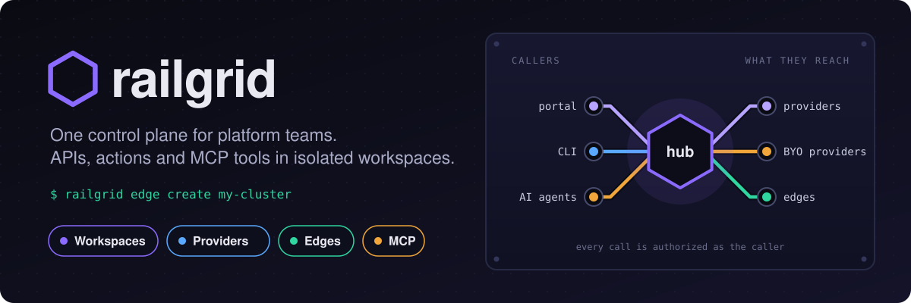
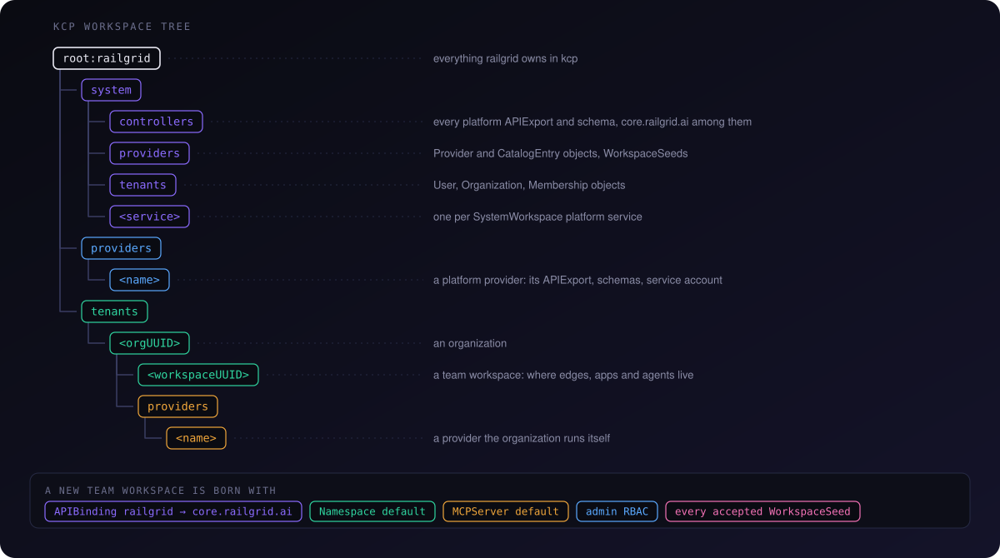
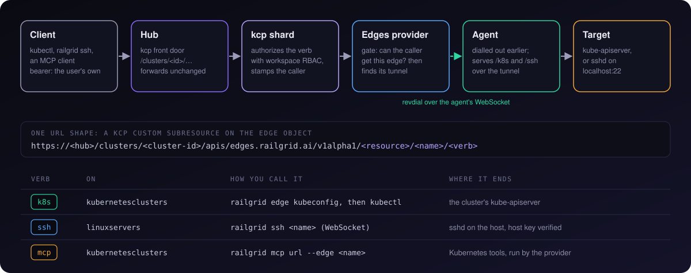

<p align="center">
  
</p>

# Developer reference

How railgrid works inside, for people changing it. To build, run and test a
change, start with [CONTRIBUTING.md](CONTRIBUTING.md); for the repository map,
the provider contract and the codegen pipeline, see [AGENTS.md](AGENTS.md).

**Contents**

- [The three planes](#the-three-planes)
- [Local development with Tilt](#local-development-with-tilt)
- [The workspace tree](#the-workspace-tree)
- [Edges](#edges)
  - [The edge kinds](#the-edge-kinds)
  - [How an edge joins](#how-an-edge-joins)
  - [The tunnel](#the-tunnel)
  - [How a call reaches an edge](#how-a-call-reaches-an-edge)
  - [SSH internals](#ssh-internals)
- [MCP](#mcp)
- [Controller reference](#controller-reference)

---

## The three planes

| Plane | What it is | Where it lives |
|---|---|---|
| **Tenancy** | kcp workspaces, organizations, users, memberships | `pkg/hub/`, `apis/tenancy/`, `pkg/kcppaths/` |
| **Providers** | Pluggable extensions: an APIExport, controllers, a backend, a portal page, MCP tools | `providers/`, `provider-sdk/`, `pkg/hub/providers/` |
| **Connectivity** | Edges, the agent, the reverse tunnel, kubectl, SSH and MCP through it | `providers/edges/`, `pkg/agent/` |

Connectivity is a provider like any other. The hub holds no edge types and no
tunnel code of its own: the kinds, their reconcilers and the tunnel endpoint
all live in the edges provider, and the hub only forwards to it.

---

## Local development with Tilt

For the fastest local dev loop, use [Tilt](https://tilt.dev/) instead of running `make` in multiple terminals.

### Prerequisites
- [tilt](https://docs.tilt.dev/install.html) ≥ v0.35.0

### Start everything

```bash
make tilt
```

Use `make tilt` to start the supported single-checkout development stack. It
allocates checkout-specific ports and resource names, creates or reuses that
checkout's kind cluster, and starts Tilt with the matching Kubernetes context
and API port. `make tilt-status` prints the saved checkout key and ports.

Bare `tilt up` still evaluates the Tiltfile's `prepare-env` helper, which
allocates the checkout's child-service ports and resource names. It bypasses
the launcher, though, so it skips the startup checks, pre-start kind-cluster
creation, Kubernetes context selection, Tilt API-port selection, and ownership
lifecycle. It uses Tilt's default API port and the current Kubernetes context,
so it can collide with another stack or target the wrong cluster. `make tilt`
and `make tilt-cluster` still cannot run side by side.

The main browser-facing resources are:

1. **`portal`** — Vite dev server on `http://localhost:<PORTAL_PORT>/ui/`; get
   the allocated port from `make tilt-status`. Builds provider portal symlinks
   automatically and watches `portal/src/` for hot reload.

2. **`hub`** — `railgrid-hub` binary with embedded KCP, static auth, and portal dev proxy  
   Serves HTTPS at `https://console-<checkout-key>.127.0.0.1.sslip.io:<HUB_PORT>`; `make tilt-status` shows the key and port. `https://localhost:<HUB_PORT>` also works. The hub depends on the portal resource and rebuilds on Go file changes.

### Smoke test

```bash
tilt_status="$(make -s tilt-status)"
hub_port="$(printf '%s' "$tilt_status" | python3 -c 'import json, sys; print(json.load(sys.stdin)["ports"]["HUB_PORT"])')"
portal_port="$(printf '%s' "$tilt_status" | python3 -c 'import json, sys; print(json.load(sys.stdin)["ports"]["PORTAL_PORT"])')"
curl -k "https://localhost:${hub_port}/healthz"   # hub healthz
curl -k "https://localhost:${hub_port}/ui/"       # portal via hub proxy
curl "http://localhost:${portal_port}/ui/"         # portal direct (Vite dev server)
```

### Stop everything

For Tilt-only shutdown, use the allocated API port:

```bash
tilt_port="$(make -s tilt-status | python3 -c 'import json, sys; print(json.load(sys.stdin)["ports"]["TILT_PORT"])')"
tilt down --port "$tilt_port"
```

For checkout-scoped teardown of this Tilt stack's processes, kind clusters, and
containers while retaining local evidence, run `make dev-browser-down`.

### Tips
- The Tiltfile intentionally skips the slow provider-portal Vite builds (`make build-hub`) because `--portal-dev-url` proxies all UI traffic to the Vite dev server.
- If the portal's allocated port is already held, check `make tilt-status`, stop the process using that port, then retry `make tilt`.

### Application preview domain

Tilt generates a checkout-specific `apps-<checkout-key>.127.0.0.1.sslip.io`
domain when `RAILGRID_APP_BASE_DOMAIN` is unset or empty. To use a custom
wildcard zone, copy [`.env.example`](.env.example) to the ignored root `.env`
file and set `RAILGRID_APP_BASE_DOMAIN` to the base zone, such as
`apps.example.com` (omit `*.`). The domain must resolve to the local preview
listener or to a trusted front proxy that forwards to it.

For these settings, precedence is Make command-line assignment, then the root
`.env`, then an inherited shell value, then the checkout default. For a
one-run override, pass the value to Make:

```bash
make tilt RAILGRID_APP_BASE_DOMAIN=apps.example.com
```

Prefixing with `RAILGRID_APP_BASE_DOMAIN=apps.example.com make tilt` supplies
only an inherited shell value; a value in root `.env` overrides it. Tilt
watches `.env` and reloads the preview Gateway and Infrastructure provider
when it changes. A Make command-line value stays in effect across those
reloads even if it matches `.env`; an explicitly empty command-line domain
keeps the checkout default, and an empty public port remains 443. Restart with
`make tilt` and no override to use the updated `.env` value.

Tilt uses this one value for the Infrastructure provider's generated app hosts,
the preview Gateway's wildcard listener and certificate, the in-cluster browser
DNS override, and the host-side tunnel probe. `RAILGRID_APP_PUBLIC_PORT` is
optional: when unset, Tilt advertises its local preview listener port; when
explicitly empty, app URLs use standard HTTPS on port 443.

If you need to run `make dev-preview-gateway-up` manually while this checkout's
Tilt stack is running, note that the standalone target's fallback domain is
`apps.127.0.0.1.sslip.io`, not the checkout-specific domain. Prefer rerunning
the Tilt-managed resource, which has the resolved domain and cluster settings:

```bash
tilt trigger preview-gateway-up --port <TILT_PORT>
```

Get `TILT_PORT`, `PREVIEW_GATEWAY_PORT`, and the checkout key from
`make tilt-status`. If you use the manual target, pass its matching target
context, listener port, wildcard hostname, and client-facing service port
explicitly:

```bash
make dev-preview-gateway-up \
  PREVIEW_GATEWAY_CONTEXT=kind-railgrid-kro-<checkout-key> \
  PREVIEW_GATEWAY_PORT=<PREVIEW_GATEWAY_PORT> \
  PREVIEW_GATEWAY_HOSTNAME='*.<base-domain>' \
  PREVIEW_GATEWAY_SERVICE_PORT=<effective-public-port>
```

Use `apps-<checkout-key>.127.0.0.1.sslip.io` as `<base-domain>` when the
resolved domain is the checkout default. The effective public port is 443 when
`RAILGRID_APP_PUBLIC_PORT` is empty, its configured value when set, or the
local listener port when unset. The target's kubeconfig defaults to
`.railgrid-kro.kubeconfig`; override `PREVIEW_GATEWAY_KUBECONFIG` too if your
running checkout uses a different file.

### Providers from other repositories

If you develop an external provider, such as the private providers in
`../providers`, add it to the `make tilt-cluster` session with
`make tilt-cluster EXTERNAL_PROVIDERS_DIR=../providers`. See
[External providers with Tilt](docs/external-providers-tilt.md) for the
settings and for the contract a provider repository implements.

---

## The workspace tree

railgrid uses [kcp](https://kcp.io) for multi-tenant API isolation: every
tenant gets a workspace that behaves like its own Kubernetes API server.

<p align="center">
  
</p>

The paths are built in one place, [`pkg/kcppaths/paths.go`](pkg/kcppaths/paths.go);
use its helpers and do not assemble a path by hand. The hub creates the tree
at startup (`Bootstrap()` in `pkg/hub/kcp/bootstrap.go`) and applies every
platform schema and APIExport into `root:railgrid:system:controllers`.

| Path | Holds |
|---|---|
| `root:railgrid:system:controllers` | Every platform APIExport and APIResourceSchema, and the `railgrid-hub` namespace for leases and secrets |
| `root:railgrid:system:providers` | `Provider` and `CatalogEntry` objects, `WorkspaceSeed`s, `SystemWorkspace`s |
| `root:railgrid:system:tenants` | `User`, `Organization`, `Membership` and the membership index |
| `root:railgrid:providers:<name>` | A platform provider's own workspace |
| `root:railgrid:tenants:<orgUUID>` | An organization |
| `root:railgrid:tenants:<orgUUID>:<workspaceUUID>` | A team workspace |
| `root:railgrid:tenants:<orgUUID>:providers:<name>` | A provider the organization registered itself ([BYO providers](docs/byo-providers.md)) |

### What a new team workspace gets

The organization reconciler and `POST` on the workspaces REST API both end in
the same calls in `pkg/hub/kcp/bootstrap.go`:

| Object | Why |
|---|---|
| APIBinding `railgrid` to `core.railgrid.ai` | Brings in `MCPServer`, with the export's permission claims accepted |
| Namespace `default` | The `workspace` type does not extend kcp's universal type, so the hub creates it |
| MCPServer `default` | The workspace's MCP endpoint, see [MCP](#mcp) |
| Admin RBAC | So the workspace has an administrator from the start |
| Every accepted `WorkspaceSeed` | Bindings and objects an administrator wants in every tenant workspace ([workspace seeds](docs/workspace-seeds.md)) |

Provider APIs are not bound at creation. A provider's APIBinding appears when
someone enables that provider in the workspace.

### Addressing a workspace

Clients never use the workspace path. They address a workspace by its kcp
logical-cluster ID, through the hub's kcp front door:

```
https://<hub>/clusters/<cluster-id>/...
```

The ID is the last segment of the server URL in the kubeconfig that
`railgrid login` writes. The hub forwards these requests to kcp unchanged, and
kcp authenticates and authorizes them.

---

## Edges

An edge is a cluster or a server that railgrid reaches without it being
reachable: an agent on the edge dials out to the hub and requests come back
down that connection.

### The edge kinds

**API group:** `edges.railgrid.ai/v1alpha1` · cluster-scoped · types in
[`providers/edges/apis/v1alpha1/`](providers/edges/apis/v1alpha1/)

| Kind | Resource | Short name | Verbs served on it |
|---|---|---|---|
| `KubernetesCluster` | `kubernetesclusters` | `kc` | `k8s`, `ssh`, `mcp`, `agent-token` |
| `LinuxServer` | `linuxservers` | `ls` | `k8s`, `ssh`, `agent-token`, `ssh-credentials` |
| `MacOSServer` | `macosservers` | `mac` | `agent-token` |

The same group holds `Service`, `Workload` and `Placement`. The verbs are
declared in [`providers/edges/manifest.yaml`](providers/edges/manifest.yaml).

**Spec.** A `KubernetesCluster` has only `labels`. A `LinuxServer` carries the
SSH settings:

```yaml
apiVersion: edges.railgrid.ai/v1alpha1
kind: KubernetesCluster
metadata:
  name: my-cluster
spec: {}                       # what `railgrid edge create` sends
---
apiVersion: edges.railgrid.ai/v1alpha1
kind: LinuxServer
metadata:
  name: my-server
spec:
  sshUserMapping: inherited    # inherited | provided | identity
  sshCredentialsRef: ""        # the Secret used when sshUserMapping is "provided"
  sshHostKey: ""               # pin the sshd host key (authorized_keys format)
  sshHostKeyPolicy: strict     # strict | tofu
```

**Status.** Every edge kind embeds the same connection status
(`ConnectionStatus` in `providers/edges/internal/edgeapi/types.go`):

```yaml
status:
  phase: Ready                 # Scheduling | Ready | Disconnected
  connected: true              # the agent's tunnel is up
  joinToken: ""                # set until the agent has enrolled, then cleared
  joinTokenHash: "…"           # SHA-256 of the token; lets an expired agent re-enrol
  hostname: "…"
  URL: "/clusters/<id>/apis/edges.railgrid.ai/v1alpha1/kubernetesclusters/my-cluster/k8s"
  agentVersion: "…"
  lastHeartbeatTime: "…"
  conditions:
  - type: Registered           # also: UpgradeAvailable, SSHHostKeyChanged
    status: "True"
  # LinuxServer only:
  sshCredentials: {username: "…", privateKeySecretRef: "…"}
  sshHostKey: "…"
```

Each part of status has one writer:

| Fields | Written by |
|---|---|
| `joinToken`, `joinTokenHash`, `Registered=False` | `TokenReconciler` |
| `connected`, `phase`, `lastHeartbeatTime`, `Registered=True` | `LifecycleReconciler`, from the tunnel's Lease |
| `hostname`, `URL`, `sshCredentials`, `sshHostKey` | The tunnel handler, when the agent connects |
| `agentVersion`, `labels`, `harnesses` | The agent's own heartbeat, every 30s |

To force a new join token, set the annotation
`edges.railgrid.ai/regenerate-join-token` on the edge.

### How an edge joins

<p align="center">
  
</p>

| # | What happens | Where |
|---|---|---|
| 1 | `railgrid edge create <name> [--type kubernetes\|server\|macos]` creates the object | `pkg/cli/cmd/edge.go` |
| 2 | `TokenReconciler` generates 32 random bytes, base64url-encoded, and writes `status.joinToken` and its hash | `providers/edges/internal/edgectrl/token_reconciler.go` |
| 3 | The CLI polls for the token and prints the install options: the agent Helm chart, `railgrid agent join`, `railgrid agent run`. `railgrid edge join-command <name>` prints them again | `pkg/cli/cmd/edge.go` |
| 4 | The agent opens a WebSocket to the hub with `Authorization: Bearer <join token>` | `pkg/agent/tunnel/tunneler.go` |
| 5 | The hub's agent ingress resolves the organization's edges provider and forwards the upgrade, passing only an allowlist of headers | `pkg/hub/providers/agent_ingress.go` |
| 6 | The provider compares the token in constant time, then asks the hub's scoped-identity service for a token (24h TTL) | `providers/edges/internal/tunnel/agent_proxy_builder_v2.go`, `agentcred.go` |
| 7 | The credential returns in the `X-Railgrid-Agent-Credential` header of the upgrade response | same |
| 8 | The agent saves it to `~/.railgrid/agent-<edge>.credential.json`, or in a pod to the Secret `railgrid-agent-<edge>-kubeconfig` | `pkg/agent/credential.go`, `pkg/agent/incluster.go` |
| 9 | The handler clears `status.joinToken`; `LifecycleReconciler` sets `connected`, `phase=Ready` and `Registered=True` | `edge_status.go`, `lifecycle_reconciler.go` |

**After enrolment.** The agent reconnects with the saved credential, not the
join token. It refreshes the credential at 80% of its lifetime through the
edge's `agent-token` verb. On restart it loads the saved file and ignores one
that is expired or was issued for a different hub or workspace. Because the
hash of the join token outlives the token, an agent whose credential has
expired can enrol again with the token it was first given.

**Why the join token is not a kcp credential.** It is a bootstrap secret that
only the edges provider can check. An enrolled agent presents a real
ServiceAccount token, which the provider verifies with a TokenReview and a
SubjectAccessReview for `create` on that one edge's tunnel.

> [!NOTE]
> Once the edge is registered the plaintext token is gone from status, so
> `railgrid edge join-command` has nothing to print. Set the regenerate
> annotation to enrol a new agent.

### The tunnel

The agent keeps one WebSocket open to the hub, and the edges provider dials
*back* over it with [revdial](provider-sdk/revdial/revdial.go). The agent never
listens on a port.

```
wss://<hub>/services/providers/edges/agent/clusters/<cluster-id>/<resource>/<name>/proxy
```

| | |
|---|---|
| Agent side | `pkg/agent/tunnel/`; reconnects with backoff from 1s up to 30s |
| Hub side | Forwards `/services/providers/edges/agent/…` to the provider (`pkg/hub/providers/agent_ingress.go`) |
| Provider side | Mounted at `/agent/`, the SDK's agent-tunnel route class (`providers/edges/main.go`) |
| Liveness | revdial pings every 18s; a Lease per tunnel, 90s TTL, renewed every 30s |

**More than one replica.** A tunnel belongs to the provider replica the agent
happened to reach. That replica records it in a Lease (`registry.go`), and a
request that lands on another replica is relayed to the owner over a
pod-to-pod listener (`remote.go`, port `EDGES_INTERNAL_PORT`, default 8090).
Relaying turns on only when `POD_IP` is set; without it the provider runs as a
single replica.

### How a call reaches an edge

<p align="center">
  
</p>

Every call to an edge is a kcp custom subresource on the edge object, so it is
authorized by the workspace's ordinary RBAC:

```
https://<hub>/clusters/<cluster-id>/apis/edges.railgrid.ai/v1alpha1/kubernetesclusters/<name>/k8s
```

That path, without the host, is what the provider writes to `status.URL`.
`railgrid edge kubeconfig <name>` puts the hub's host in front of it and
writes a kubeconfig (context `railgrid-<name>`) that authenticates as you.

1. The hub forwards `/clusters/…` to kcp unchanged.
2. kcp authorizes `kubernetesclusters/k8s` for the caller, stamps their
   identity into `X-Remote-*` headers, and the shard forwards the request to
   the edges provider.
3. The provider's gate asks kcp whether that caller may `get` the edge, then
   looks up the tunnel: its own, or another replica's through the relay.
4. The request goes down the tunnel as `/k8s/<rest of the path>`.
5. The agent serves it against the cluster's API server
   (`pkg/agent/tunnel/server.go`).

No bearer reaches the provider or the agent: the provider acts on the identity
kcp stamped. The contract is in
[docs/provider-connectivity-contract.md](docs/provider-connectivity-contract.md).

### SSH internals

#### Connection path

```
railgrid ssh <name> [-- command]                  pkg/cli/cmd/ssh.go
    │  wss://<hub>/clusters/<id>/apis/edges.railgrid.ai/v1alpha1/linuxservers/<name>/ssh
    ▼
hub ─► kcp ─► edges provider                   edgesSSHHandler, edges_proxy_builder.go
    │  GET /ssh, Upgrade: ssh-tunnel, over revdial
    ▼
agent                                          newSSHHandler, pkg/agent/tunnel/server.go
    │  raw TCP to localhost:<--ssh-proxy-port>, default 22
    ▼
sshd on the host
```

The SSH client runs in the provider, not on your machine: the provider opens
the SSH session over the tunnel and bridges it to your WebSocket. With
`-- command`, the CLI adds `?cmd=…` and the provider runs one command instead
of a shell.

#### How the provider gets SSH credentials

| When | How |
|---|---|
| The agent enrols with a join token | It sends `X-Railgrid-SSH-User` and a password or private key as upgrade headers; the provider stores them |
| The agent is already enrolled | It posts them to the edge's `ssh-credentials` verb, retrying in the background |

Either way they end up in the Secret `railgrid-system/<edge>-ssh-credentials`
with `status.sshCredentials` pointing at it. If you give the agent no
credentials it uses a key from `~/.ssh` (or generates one) and adds it to
`authorized_keys`.

#### Which user a session runs as

`spec.sshUserMapping` decides (`fetchSSHCredentials`):

| Value | Username |
|---|---|
| `inherited` (default) | The one the agent registered, `status.sshCredentials.username` |
| `provided` | The `username` key of the Secret named by `spec.sshCredentialsRef` |
| `identity` | The caller's own name, as kcp stamped it |

If none resolves, the session runs as `root`.

#### Host key verification

The provider verifies the sshd host key on every session and fails closed
(`newSSHClient` in `providers/edges/internal/tunnel/agent_proxy_builder.go`).

- **Key source.** `spec.sshHostKey` (an operator's pin) wins. Otherwise
  `status.sshHostKey`, which the agent reports each time its tunnel connects
  (`X-Railgrid-SSH-HostKey`). The provider records a reported key
  **write-once**: a later report with a different fingerprint is not applied
  and sets the `SSHHostKeyChanged` condition, with both fingerprints in the
  message. Resolve it by pinning `spec.sshHostKey` or clearing
  `status.sshHostKey`.
- **Unparseable key.** The session is refused.
- **No key known.** `spec.sshHostKeyPolicy` decides:
  - `strict` (default): the session is refused until a key is pinned or
    reported.
  - `tofu`: the key presented on the first session is trusted, recorded in
    `status.sshHostKey`, and enforced from then on.

> [!CAUTION]
> `edges-provider serve --allow-unverified-ssh-host-key` (environment
> `RAILGRID_EDGES_ALLOW_UNVERIFIED_SSH_HOST_KEY=true`, chart value
> `allowUnverifiedSSHHostKey`) opens sessions to edges with no known key
> without verifying anything. It is a legacy escape hatch: it is logged on
> startup and on every use, and never affects an edge whose key is known. A
> malformed value for the environment form (`treu`) is a startup error, not a
> silent `false`.

The handshake is bounded: `newSSHClient` arms a deadline on the tunnelled
connection (the caller's context deadline, else 30s) before
`gossh.NewClientConn`, which takes no context, and clears it once the session
is up. Without it a stalled tunnel would pin the handler goroutine.

#### Audit lines

Every session emits two structured lines at verbosity 0: `SSH session opened`
(cluster, edge, caller, SSH user, mode, exec command, remote address, host key
fingerprint) and `SSH session ended` (plus duration and error). A session
refused before it opened still gets the `ended` line, with `opened=false`. A
key trusted under `tofu` adds `SSH host key recorded on first use`. The caller
is the identity kcp stamped; when there is none the lines carry
`caller=unknown`.

Two properties keep those lines trustworthy:

- **`remoteAddr` is the last `X-Forwarded-For` hop**, not the first. One
  trusted proxy fronts this handler and *appends* the peer it saw; every entry
  to its left is supplied by the caller and can be forged. With no header the
  peer address is used, port stripped. The value is always a parsed IP or
  `unknown`.
- **`exec` is escaped and bounded.** The command is a raw query parameter;
  control characters (newlines above all, which would forge extra audit
  records) are escaped, not dropped, and the value is cut at 256 runes with an
  explicit `...[truncated]` marker.

Fingerprints distinguish `unknown` (no key recorded) from `unparseable` (a key
is recorded but malformed).

#### Keepalive

The provider sends `keepalive@openssh.com` on the SSH connection every 15s and
gives up after three consecutive failures (`providers/edges/internal/ssh/ssh.go`).
Underneath, revdial pings the tunnel every 18s.

---

## MCP

Every workspace has one [Model Context Protocol](https://modelcontextprotocol.io)
endpoint that carries the tools of every provider enabled in it. Each tool
call runs as the caller. The design is in
[docs/mcp-architecture.md](docs/mcp-architecture.md).

### The MCPServer kind

**API group:** `railgrid.ai/v1alpha1` · cluster-scoped ·
[`apis/railgrid/v1alpha1/types_mcpserver.go`](apis/railgrid/v1alpha1/types_mcpserver.go)

The hub creates one named `default` in every team workspace.

```yaml
apiVersion: railgrid.ai/v1alpha1
kind: MCPServer
metadata:
  name: default
spec:
  displayName: ""
  instructions: ""     # overrides the guidance sent to MCP clients when they connect
  readOnly: false
status:
  phase: Ready         # Provisioning | Ready | Error
  URL: "https://<hub>/services/mcpserver/<cluster-id>/apis/railgrid.ai/v1alpha1/mcpservers/default/mcp"
  tokenSecretRef: "…"  # the Secret holding this endpoint's token
  federatedProviders:  # what the endpoint currently aggregates
  - name: edges
    reachable: true
    tools: [{name: "…", title: "…", description: "…"}]
```

### Endpoints

| Endpoint | URL |
|---|---|
| The workspace | `https://<hub>/services/mcpserver/<cluster-id>/apis/railgrid.ai/v1alpha1/mcpservers/<name>/mcp` |
| One cluster edge | `https://<hub>/clusters/<cluster-id>/apis/edges.railgrid.ai/v1alpha1/kubernetesclusters/<name>/mcp` |
| One edge `Service` | `https://<hub>/clusters/<cluster-id>/apis/edges.railgrid.ai/v1alpha1/services/<name>/mcp` |

The per-edge endpoints are the `mcp` verb on the edge object, so they take the
same path as [any other call to an edge](#how-a-call-reaches-an-edge).

### Request flow for the workspace endpoint

```
MCP client (Claude Code, Codex, Cursor, …)
    │  POST /services/mcpserver/<cluster-id>/…/mcpservers/default/mcp
    │  Authorization: Bearer <token>
    ▼
hub: pkg/hub/mcpaggregate
    │  1. Parse the cluster ID and the MCPServer name from the path
    │  2. Verify the bearer: the MCPServer's own token, or a member user
    │  3. List the Ready providers this caller's organization can see
    │  4. Discover each provider's tools (cached per caller)
    │  5. Serve one stateless MCP server over streamable HTTP
    ▼
each provider's own /mcp
    │  platform provider:  <backend>/mcp, with the caller's bearer and the cluster ID
    │  org-owned provider: over an edge, with a short-lived delegated token
    ▼
the provider acts as the caller, in the caller's workspace
```

The aggregate uses the official
[`modelcontextprotocol/go-sdk`](https://github.com/modelcontextprotocol/go-sdk).
It works with no providers enabled; the tool list is then empty.

`pkg/hub/controllers/mcpserver/` is the reconciler behind the kind: it
provisions each MCPServer's ServiceAccount, token Secret and RBAC, writes
`status.URL`, and refreshes `status.federatedProviders`.

### Kubernetes tools

The Kubernetes tools come from the edges provider, which embeds
[`containers/kubernetes-mcp-server`](https://github.com/containers/kubernetes-mcp-server).
Its toolsets register themselves from blank imports in
`providers/edges/internal/tunnel/mcp_builder.go`:

```go
_ "github.com/containers/kubernetes-mcp-server/pkg/toolsets/config"
_ "github.com/containers/kubernetes-mcp-server/pkg/toolsets/core"
_ "github.com/containers/kubernetes-mcp-server/pkg/toolsets/helm"
_ "github.com/containers/kubernetes-mcp-server/pkg/toolsets/kcp"
_ "github.com/containers/kubernetes-mcp-server/pkg/toolsets/kiali"
_ "github.com/containers/kubernetes-mcp-server/pkg/toolsets/kubevirt"
```

Without an import its tools do not exist: `tools/list` simply omits them.

On the provider's fleet endpoint a tool picks its cluster with a `cluster`
argument, which takes an edge name. It is called `cluster`, not `edge`,
because that is the word users reach for.

### Adding it to an MCP client

```bash
railgrid mcp url --mcpserver-name default   # the workspace endpoint
railgrid mcp url --edge my-cluster          # one cluster
```

Each prints the endpoint and the configuration to paste into an MCP client.
Exactly one of the two flags is required. By hand:

```bash
claude mcp add --transport http railgrid \
  "https://<hub>/services/mcpserver/<cluster-id>/apis/railgrid.ai/v1alpha1/mcpservers/default/mcp" \
  -H "Authorization: Bearer <token>"
```

---

## Controller reference

### Hub

Registered in `pkg/hub/server.go`.

| Controller | Package | Responsibility |
|---|---|---|
| `mcpserver` | `pkg/hub/controllers/mcpserver/` | Provisions each MCPServer's identity, publishes its URL, refreshes its tool list |
| `user`, `organization-lifecycle` | `pkg/hub/controllers/organization/` | A user gets a personal organization; an organization gets its workspace, a default team workspace, the core binding, admin access and a default MCPServer |
| `softdelete` | `pkg/hub/controllers/softdelete/` | 30-day grace period, then cascading deletion, for users, organizations and workspaces |
| `membershipindex` | `pkg/hub/controllers/membershipindex/` | Repairs the per-user membership index |
| `provider-catalog` | `pkg/hub/providers/controller.go` | Syncs CatalogEntries into the in-process registry the proxies route from |
| `provider-provisioner` | `pkg/hub/providers/provider_controller.go` | A `Provider` object becomes a provider workspace, its `provider` ServiceAccount and a kubeconfig Secret |
| `system-workspace-provisioner` | `pkg/hub/providers/system_workspace_controller.go` | The same for a `SystemWorkspace` under `root:railgrid:system` |
| `provider-binding-claims` | `pkg/hub/providerclaims/` | Keeps each tenant APIBinding's permission claims in step with the provider's `spec.requires` |
| `workspace-seeds` | `pkg/hub/workspaceseeds/` | Validates WorkspaceSeeds and applies them to every tenant workspace |
| `providerinstall` | `pkg/hub/providerinstall/` | Cleans up provider workspaces the installer created when their organization goes |
| `metering-organization`, `metering-provider-binding` | `pkg/hub/metering/` | Per-organization metering objects and bindings; only when metering is installed |

The scoped-identity service (`pkg/hub/identity/`) materializes and
garbage-collects the identities providers ask for. It is a sweep paced by token
lifetime, not a controller-runtime controller.

### Edges provider

One leader-elected multicluster manager (`providers/edges/controller_manager.go`).
The four `edgectrl` controllers are registered once per edge kind.

| Controller | File under `providers/edges/internal/` | Responsibility |
|---|---|---|
| `token-<resource>` | `edgectrl/token_reconciler.go` | Mints the join token and its hash; handles the regenerate annotation |
| `edge-rbac-<resource>` | `edgectrl/rbac_reconciler.go` | Asks the hub for the agent's scoped identity; revokes it when the edge is deleted |
| `version-<resource>` | `edgectrl/version_reconciler.go` | Maintains `UpgradeAvailable` against the hub's version |
| `lifecycle-<resource>` | `edgectrl/lifecycle_reconciler.go` | The only writer of `connected`, `phase` and `Registered=True`, from tunnel Leases |
| `scheduler` | `scheduler/` | Fans a `Workload` out into `Placement`s on matching clusters |
| `status-aggregator` | `status/` | Rolls `Placement` status up into the `Workload` |
| `service-discovery-*` | `servicectrl/discovery_reconciler.go` | Pulls host services from the agent into `Service` objects |
| `service-validation` | `servicectrl/validation_reconciler.go` | Checks a `Service`'s credentials over the tunnel; writes its status and URLs |

Other providers document their controllers in their own architecture docs
under [`docs/`](docs/).
