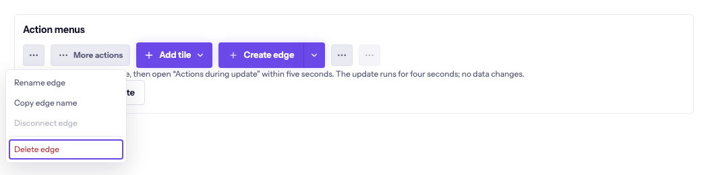
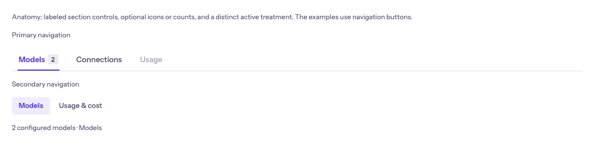
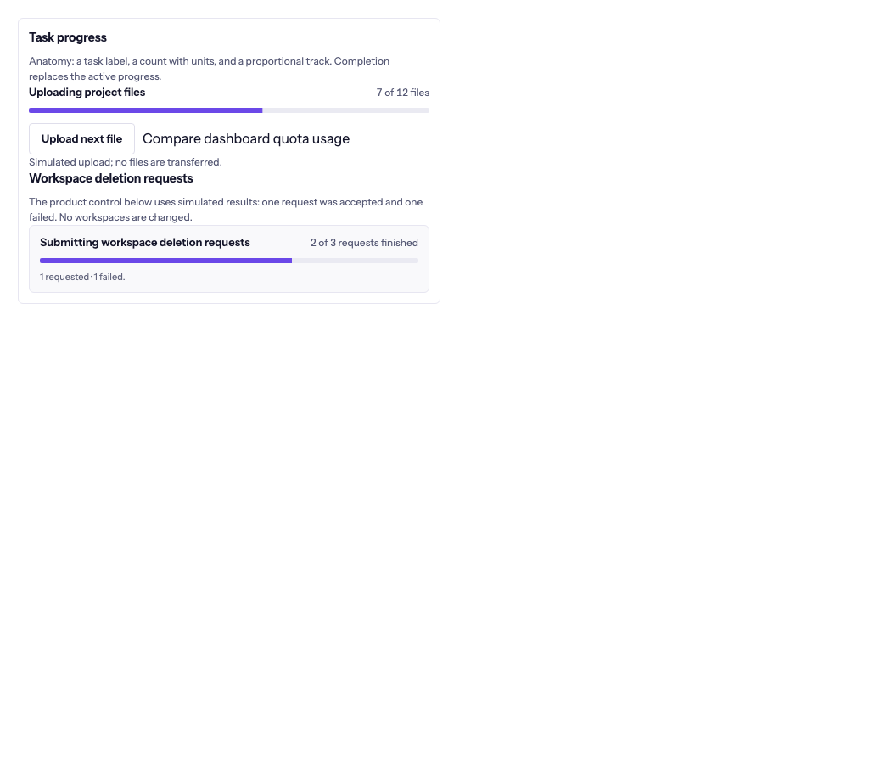
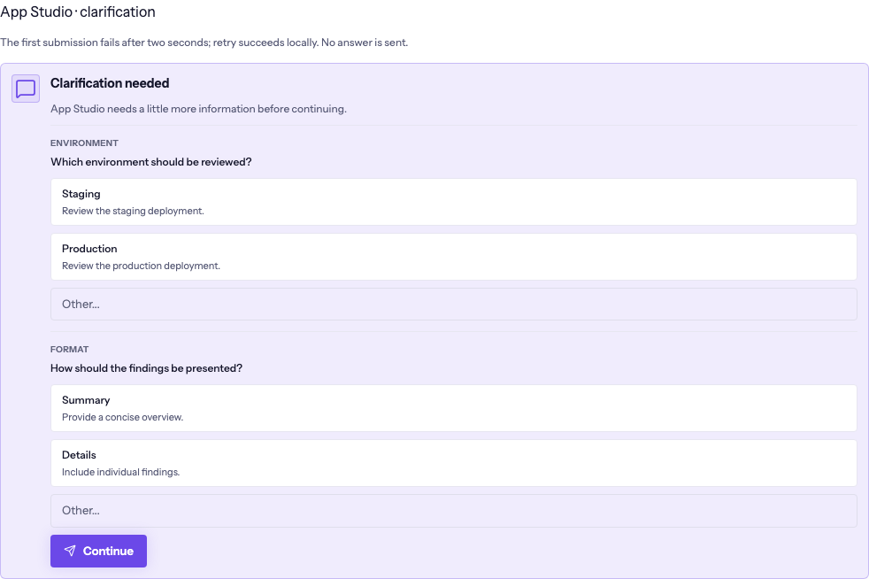
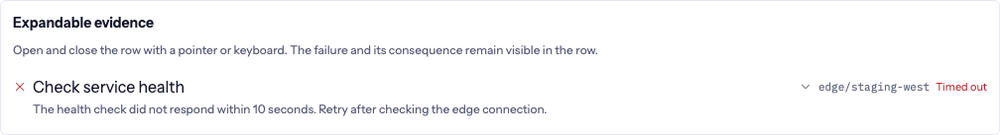
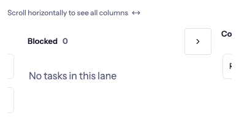
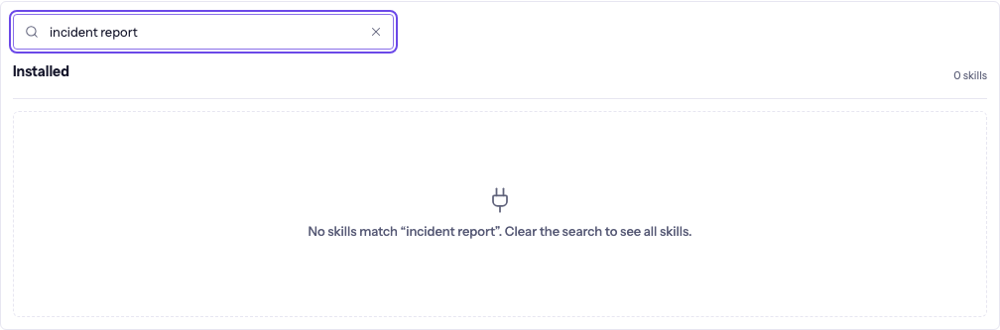
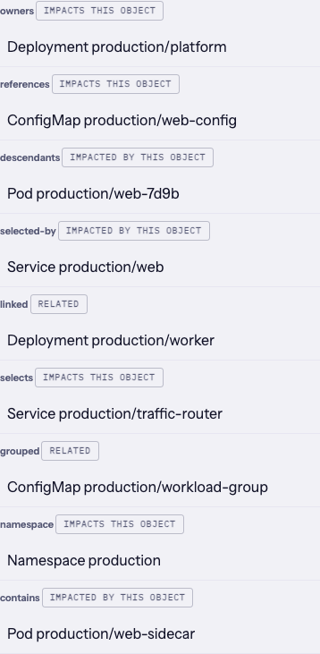

# Geist comparison: visual review of component changes

This review covers the changes made during the Geist-informed comparison, through commit `c9069b15b`. The images show current **local fixtures with simulated data**, not production or before-and-after comparisons. For each component, the image provides context; the accompanying interaction explains what changed. The [component audit](geist-component-audit.md) includes comparisons, evidence and remaining verification limits for all catalog entries.

## ActionMenu

**Changed:** With the menu open, typing a letter moves focus to a matching enabled action. Here, typing **D** skips the unavailable Disconnect action and focuses Delete. The transparent trigger and violet focus treatment remain Railgrid's.

**Review in context:** Open [ActionMenu](http://127.0.0.1:5597/?entry=design.components.action-menu), activate the first menu and type `D`. The product fixture link in the book leads to Edge Services when its fixture server is running.

## Route tabs

**Changed:** Route tabs can now render real links, retaining behaviors such as opening a destination in a new tab. Local section choices remain buttons. The picture shows the previously reviewed primary and secondary styling; the new link behavior is not visible in the still image, and this specimen uses buttons.

**Review in context:** [Tabs review](http://127.0.0.1:5597/?entry=design.components.tabs); see [Tabs.vue](../../provider-sdk/portalkit-vue/Tabs.vue) and the Edge Services routes for the route-link implementation.

## Task progress

**Changed:** Workspace deletion progress exposes current counts while batching announcements, so a screen reader does not hear an announcement for every request. The final counts remain available. The image shows the simulated product control below a separate upload example.

**Review in context:** [Progress review](http://127.0.0.1:5597/?entry=design.components.progress). The timing and spoken announcements need interactive assistive-technology review; they cannot be assessed from the image.

## AI interruption and clarification

**Changed:** App Studio groups clarification questions and keeps the submit action focused while the request is pending. The fixture can simulate a failure and retry; it does not submit a real answer.

**Review in context:** [AI interruption review](http://127.0.0.1:5597/?entry=design.components.ai-interrupt). Under “App Studio · clarification,” answer both questions and select Continue to try the simulated failure and retry.

## AI activity row

**Changed:** Expandable activity rows keep their disclosure target present while the detail content is loaded only when expanded. The failure and outcome remain visible in the row.

**Review in context:** [AI activity row review](http://127.0.0.1:5597/?entry=design.components.ai-action-row); expand and collapse the failed health check with a pointer or keyboard.

## ResourceBoard

**Changed:** The control for hiding an empty lane now has a **44 × 44 pixel** target on coarse pointers. Desktop sizing is unchanged. The screenshot shows the revealed Blocked lane at a mobile width.

**Review in context:** [ResourceBoard review](http://127.0.0.1:5597/?entry=design.components.resource-board); reveal Blocked, then hide it. The board is a synthetic fixture rather than a live Planner view.

## Skill catalog

**Changed:** A search with no matches identifies the query and points to the existing clear control. Very long queries are shortened in the message while the input retains the full value.

**Review in context:** [Skill catalog review](http://127.0.0.1:5597/?entry=design.components.skill-catalog); search for an absent skill and clear the search. The fixture also includes an App Studio workbench example.

## Impact relationship graph

**Changed:** Impact opens its grouped, named List by default at widths of 600px or less. Graph stays available; resizing does not override a user's choice. The graph legend and graph-specific instructions appear only in Graph, so they do not push the List down the page. Analysis limits and warnings remain visible in both views.

**Review in context:** [Kuery Impact all-relations fixture](http://127.0.0.1:5597/kuery-impact.html?scenario=all-relations). This combines nine synthetic relation types for inspection, not a realistic topology. Edge labels in the fitted graph can still be small, and some line colors/styles appear similar in color-vision simulations; see [known oddities](../design/quality/known-oddities.md).

## Open the review

Run `make serve-design-review` and use the port printed by the server. The links above use port 5597, the local server used for these screenshots; substitute your port if needed. Product fixtures may need separate servers, as described in the [review setup](../../hack/design-review/README.md).
