# Railgrid design changes: an illustrated review

This guide explains the changes on `codex/railgrid-design-book` through **d087a4c24**, compared with its merge base **538ffedd434bfe3e800d72ef64917e481a234169**. That snapshot contains **250 commits and 916 changed files**, including tests, fixtures and copies of shared components. The pictures below show the **current state of local fixtures with simulated data**. They are not before-and-after images, screenshots of production, or evidence that every product route has been verified.

For the complete scope, use the [changed-file inventory](design-tour/changed-files.txt), [commit inventory](design-tour/commits.txt), and the actual patch:

```sh
git diff 538ffedd434bfe3e800d72ef64917e481a234169 d087a4c24
```

The [earlier review map](railgrid-design-review-summary.md) distinguishes the component designs you approved in our conversation from later work requiring a fresh review. Your approval of a specimen at one point does not automatically approve every subsequent code change or product adoption. This illustrated guide groups related changes so it does not pretend that one screenshot explains each of the 916 files.

## 1. Design book and foundations

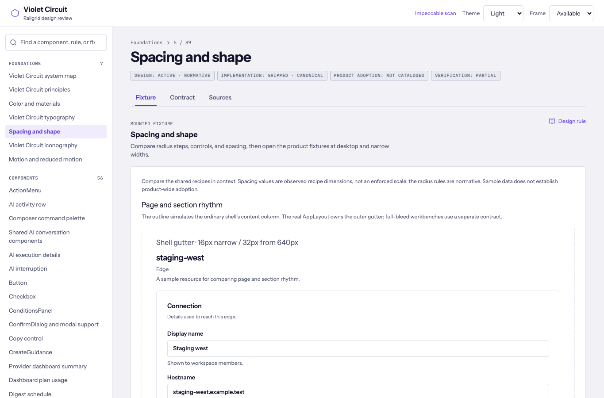

**What changed:** The book has a navigable catalog with a fixture, written contract, source references and example product uses for each entry. Foundations are now organized around principles, color and materials, typography, spacing and shape, iconography, and motion. The screenshot shows the dedicated spacing example: a simulated page gutter, a real resource page and section card, field rhythm, and shape examples further down. Implementation guidance is accessible from related contracts without occupying the review navigation.

**Why:** A reviewer can discuss the visual rule and the component that implements it in the same place. Observed spacing and material roles are labeled as review observations rather than asserted as universally adopted tokens.

**Where:** [Design-book overview](../design/README.md), [Spacing and Shape contract](../design/foundations/geometry.md), [fixture](../../hack/design-review/SpacingStage.vue), and [review application](../../hack/design-review/Review.vue). These pages and examples do not by themselves prove product-wide conformance.

## 2. Shared status and feedback

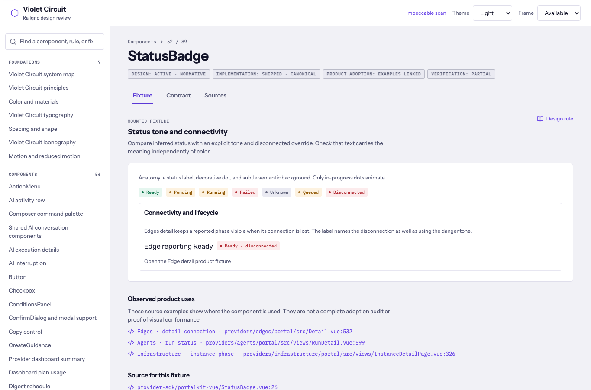

**What changed:** Status badges use restrained semantic backgrounds and lighter text treatment; only in-progress dots animate. Status labels distinguish conditions such as a resource reporting ready while disconnected. Shared feedback also includes transient success messages, persistent messages when a decision is needed, and link, action and undo variants. Spinners, progress, usage meters and timestamps have clearer labels and accessible behavior.

**Where used:** Edge Services rows and edge detail, agent runs, infrastructure instances, dashboard usage and other provider views. See [StatusBadge](../../provider-sdk/portalkit-vue/StatusBadge.vue), [toast contract](../design/components/toast.md), [progress contract](../design/components/progress.md), and [timestamps](../design/components/timestamp.md).

**What a still image cannot show:** Timing, reduced motion, precise timestamp disclosure, screen-reader announcements and failure recovery. Those need interaction review.

## 3. Navigation, buttons, inputs and forms

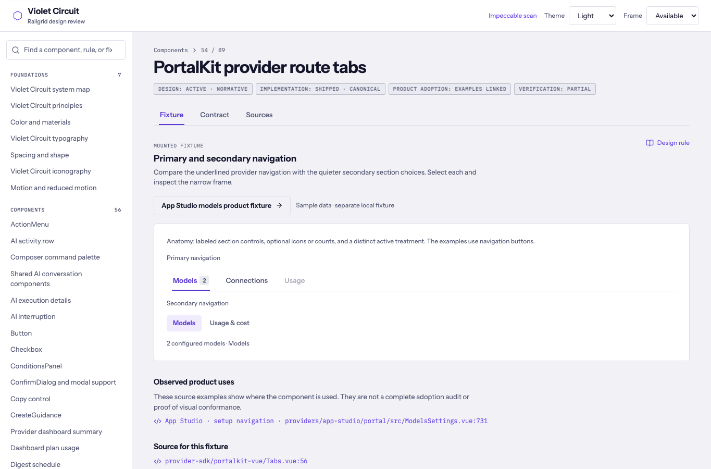

**What changed:** Primary provider tabs use a violet underline and no filled hover; secondary tabs are quieter and smaller. Secondary buttons use a surface-matching background and border instead of a pervasive gray fill. Inputs retain a violet focus indication, quieter surfaces and explicit errors. The book includes states for selects, search, textarea, checkbox, radio, toggle, field groups, uploads and validation. Menu triggers stay visible and transparent; busy actions keep their focus.

**Where used:** Agents setup and creation, Edge Services filters, App Studio models and Infrastructure forms. See [Tabs](../../provider-sdk/portalkit-vue/Tabs.vue), [shared CSS](../../provider-sdk/portalkit/railgrid-ui.css), [FormSelect](../../provider-sdk/portalkit-vue/FormSelect.vue), and [Infrastructure DynamicForm](../../providers/infrastructure/portal/src/components/DynamicForm.vue).

**Behavior beyond appearance:** The branch also changes keyboard and IME handling, field descriptions, error focus, disabled choices, type preservation for enum values and mobile resizing. These changes need review alongside the visual treatment.

## 4. First use, empty results and recovery

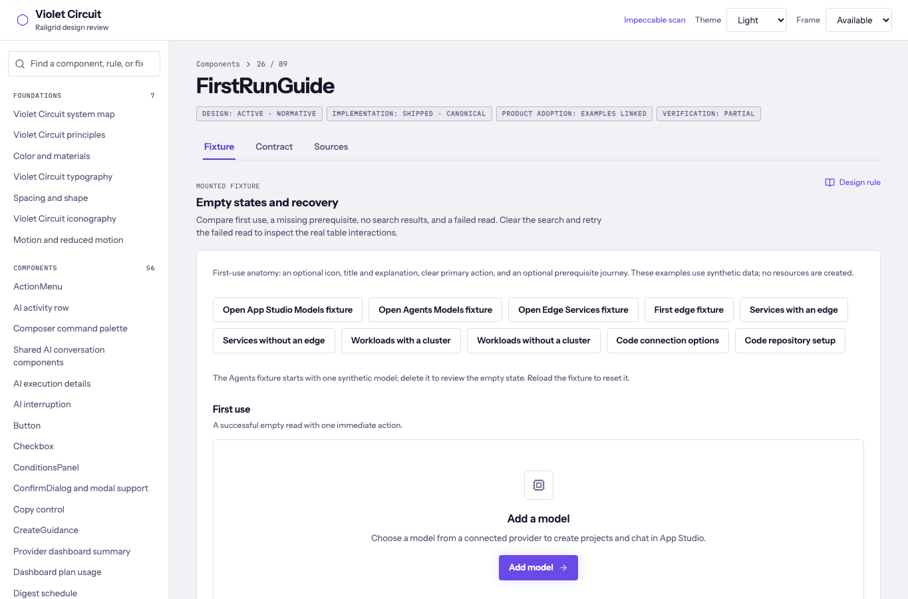

**What changed:** First-use states explain what the user can do next and offer a focused action. A guided treatment remains for multi-step setup. No-results and failed reads are separate from a successful empty collection. In many views a background refresh retains the last known content, while retry and refresh actions communicate pending work without discarding focus.

**Where used:** Model setup, Edge Services and workloads, Agents collections, Code connections and repositories, Infrastructure catalog and Quickstart. See [FirstRunGuide](../../provider-sdk/portalkit-vue/FirstRunGuide.vue) and [resource reads](../design/patterns/resource-reads.md).

## 5. Edge Services: tables and row actions in context

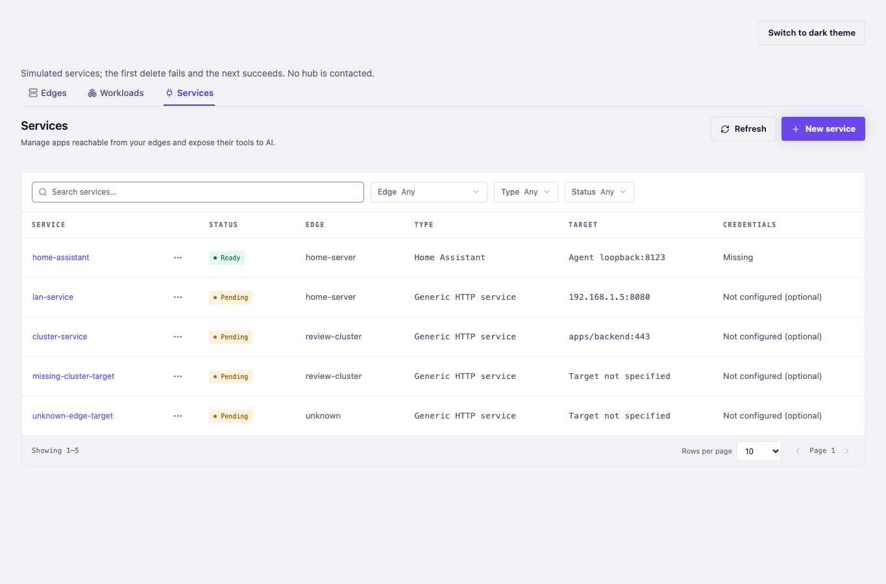

**What changed:** The Services collection has a quieter table, clearer search and filters, persistent transparent row menus, status badges and a compact pagination footer. Target labels distinguish agent loopback, a LAN host, a Kubernetes Service and a missing target. The create/edit flows also gained clearer validation and guidance for host, scheme, port, labels and credentials.

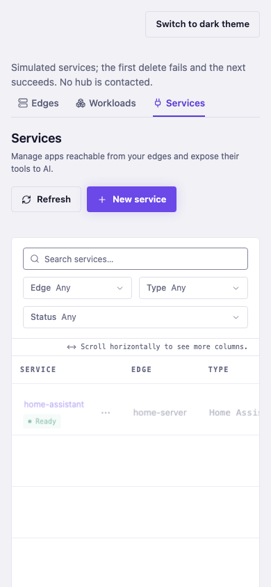

**On mobile:** The table keeps its horizontal-scroll behavior rather than crushing all columns; row actions and controls remain reachable. The picture is one synthetic scenario, not an audit of every narrow screen.

**Where:** [Services.vue](../../providers/edges/portal/src/Services.vue), [service target formatting](../../providers/edges/portal/src/serviceTarget.ts), and [Edge service setup](../design/journeys/edge-service-setup.md). The screenshot is the actual Services component rendered with simulated data; it does not contact a hub.

## 6. Agents: investigating a run

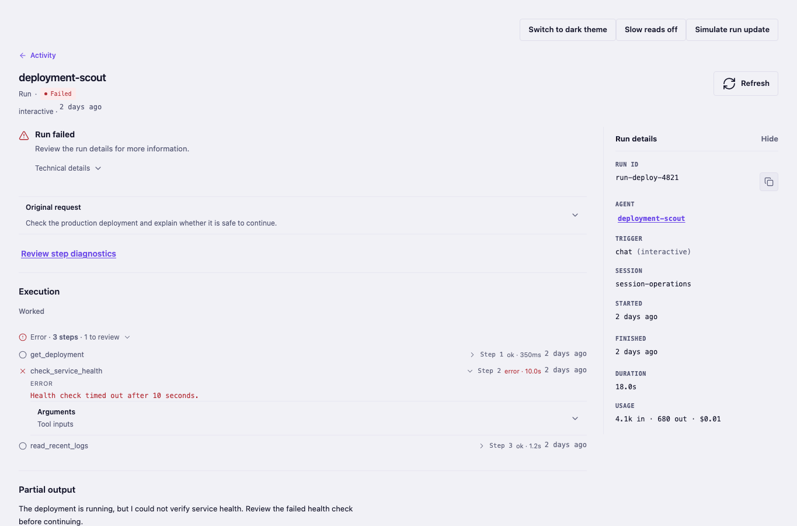

**What changed:** The investigation example puts the failure, original request, step diagnostics and partial output in a scannable sequence, with run metadata alongside. Disclosure rows, timestamps, status and copy controls use the shared language. The actual Agents portal also received related changes to run detail, Activity, chat interruptions, approvals, questions, toolsets, connections, models, skills, webhooks, automation and schedules.

**Interaction changes:** Refreshes and retries preserve context and focus; the inbox serializes/coalesces overlapping reads. Error and loading states are more distinct. These are behavioral changes in addition to the visual composition.

**Where:** [Agents views](../../providers/agents/portal/src/views/), [run detail](../../providers/agents/portal/src/views/RunDetail.vue), and [AgentKit components](../../provider-sdk/agentkit-vue/). The picture is the **design example** with synthetic run data, not a live agent execution.

## 7. Infrastructure: deployment detail and provisioning

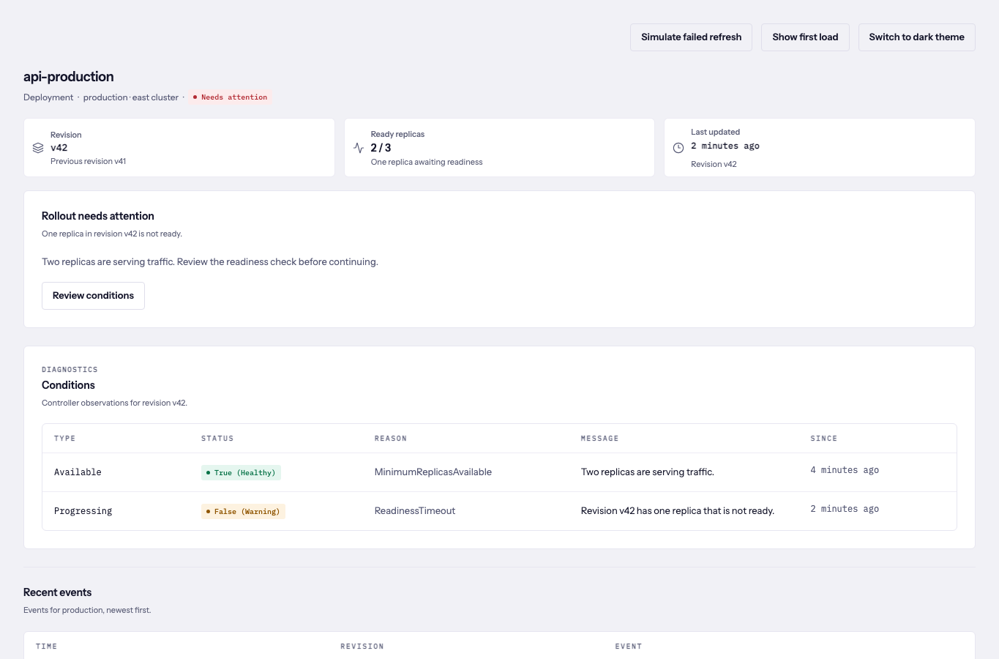

**What changed:** The deployment example uses restrained summary cards, concise rollout copy, clear status and a conditions table; Recent events uses a divider instead of another heavy card. In the actual Infrastructure portal, resource pages, catalog and instance reads, retry states, provisioning forms, enum selection and narrow-screen map controls were also revised.

**Where:** [Infrastructure views](../../providers/infrastructure/portal/src/views/), [DynamicForm](../../providers/infrastructure/portal/src/components/DynamicForm.vue), and [deployment example](../../hack/deployment-detail-visual/Example.vue). This picture is a synthetic **design example**; it does not represent a live deployment.

## 8. Models and provider connections

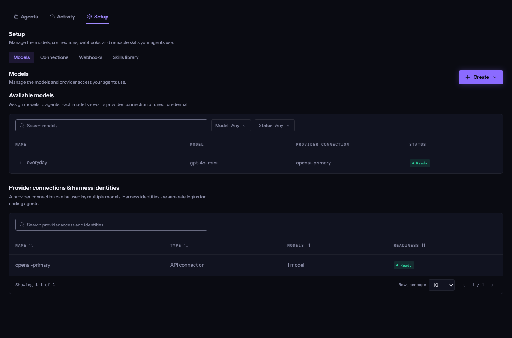

**What changed:** Models and provider connections are explained as related but distinct: a connection can be reused by models, while model bindings identify what an agent or project uses. The fixture illustrates the quieter secondary navigation, table, filters and readiness badges in dark mode. Agents and App Studio also received model/connection validation, retry and focus changes.

**Where:** [model connections contract](../design/components/model-connections.md), [Agents model views](../../providers/agents/portal/src/views/), and [App Studio ModelsSettings](../../providers/app-studio/portal/src/ModelsSettings.vue). The screenshot uses a simulated model and connection; no external model is called.

## 9. App Studio: sharing and workbench

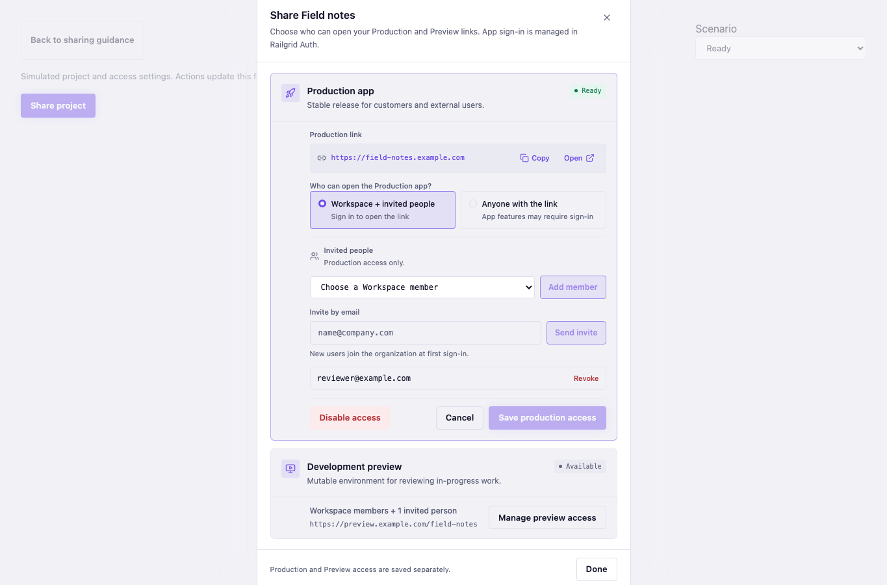

**What changed:** The sharing fixture presents Production and Development preview access as separate areas, with explanatory copy and distinct actions. The branch also changes project/workbench presentation, model and integration setup, sharing focus, recovery feedback and the preview annotation picker. Keyboard users can navigate visible preview elements and select one for annotation; the comment field has a visible focus indication.

**Where:** [ProjectShareDialog.vue](../../providers/app-studio/portal/src/ProjectShareDialog.vue), [App.vue](../../providers/app-studio/portal/src/App.vue), and [preview bridge](../../providers/infrastructure/dev-agent/preview-bridge-plugin.mjs). Access changes in the picture are simulated. Host-toolbar focus return after annotation cancellation, cross-browser behavior and assistive-technology behavior remain open review items.

## 10. Kuery and the other products

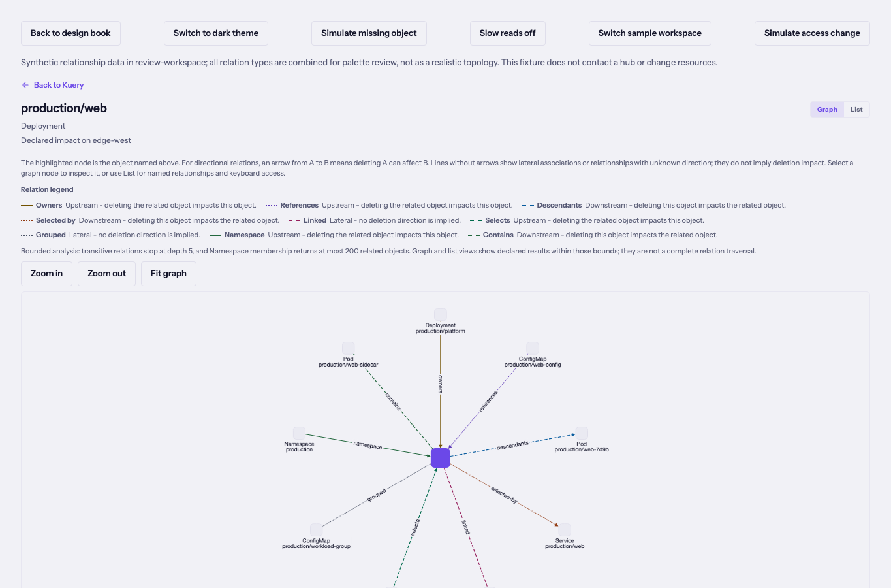

**Kuery:** Impact and topology views gained relationship descriptions, legend and line-style distinctions, a list alternative, clearer bounded-analysis copy and recovery/resize behavior. Some simulated color-vision checks still show similar lines; the labeled list is an important alternative. See [graph.ts](../../providers/kuery/portal/src/graph.ts) and the [relationship graph contract](../design/components/relationship-graph.md).

**Host portal:** Organization/workspace entry, dashboard, provider loading and recovery, navigation, billing and MCP-related journeys received presentation, validation and focus/retry changes. See [host pages](../../portal/src/pages/) and [journeys](../design/journeys/).

**Code:** Connection, repository and package lists and details gained clearer read/failure states, retries and native link behavior. See [Code views](../../providers/code/portal/src/views/).

**Quickstart:** Shared controls, row actions, refresh and retry behavior were aligned with the shared patterns. See [Quickstart portal](../../providers/quickstart/portal/src/).

These are grouped descriptions of the diff. The [file](design-tour/changed-files.txt) and [commit](design-tour/commits.txt) inventories include their full changed scope, including tests and sync outputs that are not pictured here.

## 11. Changes that are not visible in a screenshot

- **Shared components and distribution:** Canonical PortalKit and AgentKit changes are copied into the host and provider bundles. Menu placement and focus, modal stacking, selection, pagination, loading/error announcements, focus restoration, reduced motion and touch targets are important parts of the change. See [PortalKit](../../provider-sdk/portalkit-vue/) and the [asset index](../design/components/portalkit-assets.md).
- **Dialogs and popups:** Confirmations use native modal behavior and optional irreversible/typed confirmation; shared popups can use the browser top layer within ARIA modals. Without Popover support, the documented fallback can sit outside an ARIA modal's focus boundary. See [confirmation](../design/components/confirm-dialog.md) and [known oddities](../design/quality/known-oddities.md).
- **Backend behavior:** The workspace API adds a recovery deadline for qualifying non-forced deletions, and the App Studio model-catalog renderer supplies a reduced portal-facing JSON projection. Review [workspace handling](../../pkg/hub/restapi/workspaces.go) and [catalog rendering](../../providers/app-studio/api/modelcatalogjson/render.go) as API changes, not visual changes.
- **Verification and tooling:** New and expanded fixtures, mounted tests, source/asset checks and conformance checks accompany the work. Synthetic fixtures and passing checks do not prove live backend behavior, deployment status, OAuth flows, cross-browser behavior or assistive-technology conformance.

## 12. Later interaction and accessibility work

The screenshots above were captured for the earlier **f7c221fa6** snapshot. Three subsequent code commits add interaction changes that a still image cannot show:

- **Action menus:** typing printable characters moves focus to matching enabled menu items. The App Studio code explorer also exposes its action as a menu trigger. See [ActionMenu](../../provider-sdk/portalkit-vue/ActionMenu.vue).
- **Tabs and navigation:** provider route tabs can use native links, while local choices remain buttons; Edge Services supplies route URLs. This preserves link behaviors such as opening in a new tab. See [Tabs](../../provider-sdk/portalkit-vue/Tabs.vue) and [Edges routes](../../providers/edges/portal/src/routes.ts).
- **Feedback and activity:** workspace deletion announces progress at intervals and final counts; App Studio review questions preserve pending-action focus; AI activity disclosure targets stay present while their content remains lazy. See [workspace settings](../../portal/src/pages/TenantSettingsPage.vue), [review request](../../providers/app-studio/portal/src/ReviewRequest.vue), and [AIActionRow](../../provider-sdk/agentkit-vue/AIActionRow.vue).

The [component comparison ledger](geist-component-audit.md) records the scope and remaining verification for the ongoing Geist-informed review. These later changes need their own user review; the earlier screenshots and approvals do not cover them. Uncommitted work in the checkout is not part of this snapshot.

## Reviewing the result interactively

Run `make serve-design-review` and open <http://127.0.0.1:5197/>. The book offers **Fixture**, **Contract** and **Sources** views. Product fixtures use separate servers listed in the [review setup guide](../../hack/design-review/README.md). The screenshots in this guide can be reviewed without starting those servers.
